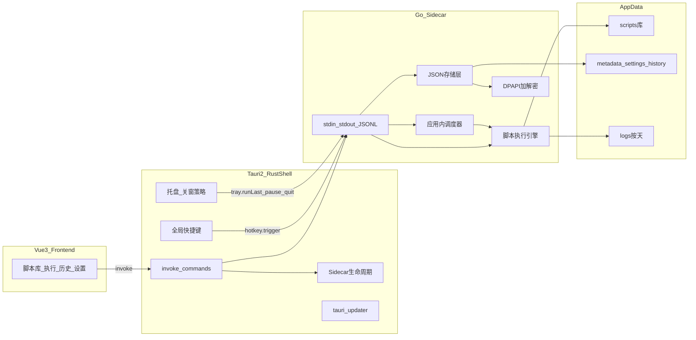
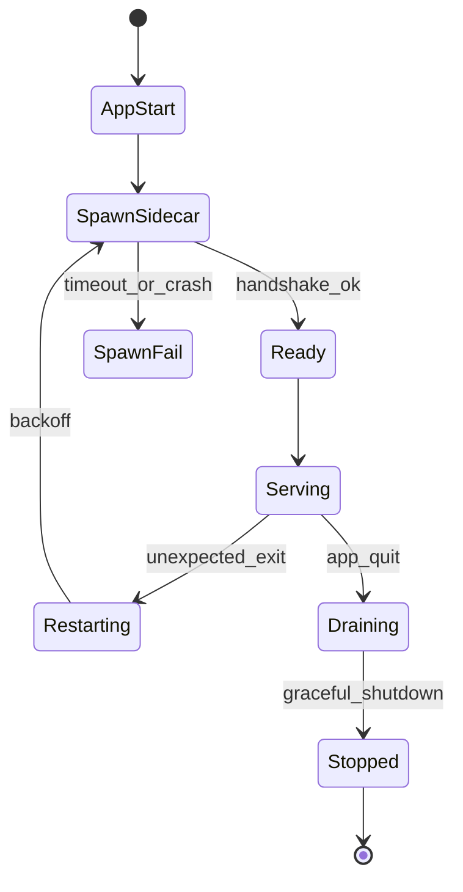

# Easy Command 架构设计

> 状态：框架设计初稿  
> 平台：仅 Windows 10/11  
> 技术栈：Tauri 2 + Rust 桌面壳 + Vue 3 + TypeScript + Vite + Go 1.22+ Sidecar

本文档描述项目目标、分层职责、目录布局、Sidecar 生命周期、IPC 协议、数据模型、调度与快捷键、自动更新与首次引导。实现细节见 [DEV_PLAN.md](./DEV_PLAN.md)。

---

## 1. 项目目标与 MVP 范围

### 1.1 目标

在 Windows 10/11 上提供图形化脚本库：将本地 `.bat` / `.sh` 复制入库，手写参数元数据，一键执行并实时查看输出与退出码，保留执行历史；支持应用内定时任务、全局快捷键、托盘常驻与自动更新，无需手动打开终端。

### 1.2 MVP 做什么

- 脚本导入（复制到 `%APPDATA%` 工具库）、同名冲突处理、库内脚本编辑
- 手写脚本元数据与参数定义（含 `password` 类型 + DPAPI 加密存储 + 日志脱敏）
- 执行 `.bat`（`cmd.exe`）与 `.sh`（Git Bash `bash.exe`：自动探测 + 允许手动指定路径）
- 实时 stdout/stderr 流、退出码；执行历史持久化
- 应用内调度器：cron / 固定间隔 / 每天某时刻（应用退出后不执行）
- 全局快捷键触发「最后选中脚本」；选中 ID 持久化与失效处理
- 托盘：关闭窗口最小化到托盘、首次关闭提示；菜单含打开主界面、运行最近脚本、暂停定时任务、退出
- JSON 文件存储（不用 SQLite）；按天日志保留（不清理 / 定时清理）
- 首次运行引导（数据目录初始化、Git Bash 检测）；Tauri Updater 自动更新（不强制代码签名）

### 1.3 MVP 不做什么

- macOS / Linux；SQLite / 远程同步 / 多用户协作
- 参数自动从脚本解析（`%1` / `$1` / `param()`）
- 系统级计划任务（应用退出后仍跑）、开机自启（可后续迭代）
- 脚本市场、权限沙箱隔离、代码签名分发
- 复杂工作流编排（多脚本依赖链）、SSH 远程执行

---

## 2. 整体架构

### 2.1 分层示意



### 2.2 职责边界

| 层 | 职责 | 不负责 |
| --- | --- | --- |
| **Vue 前端** | UI、表单校验展示、订阅流式输出事件；`dangerous` 脚本的 manual 二次确认 | 不直连 Sidecar；不碰 DPAPI / 文件系统细节 |
| **Rust 壳** | 窗口 / 托盘 / 快捷键 / Updater；拉起与监管 Sidecar；`invoke` → JSONL 转发；向前端 `emit` 流事件；hotkey/tray 触发时的二次确认弹窗 | 不执行脚本；不做业务 JSON CRUD；不做调度 tick；**不缓存** `lastSelectedScriptId` / `lastRunScriptId` |
| **Go Sidecar** | 全部业务：脚本库、元数据、执行、历史、设置、调度、DPAPI、日志脱敏与清理；维护并落盘 `ui_state.json` | 不画 UI；不注册全局快捷键 |
| **JSON 存储** | 唯一持久化；原子写；文件锁约定 | 无 DB 事务 |

### 2.3 数据流（执行一例）

1. 前端 `invoke('script_run', { scriptId, args })`（若 `dangerous=true` 且 trigger=manual，前端先二次确认）
2. Rust 生成 `requestId`，向 Sidecar stdin 写一行 JSON request
3. Sidecar 生成 `runId`，进程**成功启动**后立刻回 `res`（`ok: true, payload: { runId }`）；随后读元数据解密、读管道，按行发出带 `runId` 的 `exec.*` 事件
4. Rust 读 stdout 协议行，按 `requestId` / `event` / `runId` 通过 `app.emit` 推给前端；前端用 `runId` 过滤事件、用 `requestId` 关联发起请求
5. `exec.exit` 为该 run 的终结事件；之后 Sidecar 写 history（脱敏后的参数快照）

### 2.4 DPAPI 取舍：放在 Go Sidecar

**结论：在 Go 侧做 `CryptProtectData` / `CryptUnprotectData`。**

理由：

- 密钥材料只在「拥有元数据与执行权」的进程内明文瞬态存在，避免 Rust ↔ Go IPC 反复传明文密码。
- 存储 CRUD 与执行同属 Go，加密读写闭环简单。
- Rust 仅转发；前端只收「已设置 / 未设置」状态，不回显密文。

用户须知（首次引导文案）：密文绑定**当前 Windows 用户配置文件**；换用户、重装系统或漫游到其他机器无法解密，需重新填写。

### 2.5 危险脚本二次确认

`ScriptMeta.dangerous: boolean`（默认 `false`）。

| 触发源 | `dangerous=true` 时 |
| --- | --- |
| `manual` | **前端**弹二次确认，确认后再发 `script.run` |
| `hotkey` / `tray` | Rust 发 `hotkey.trigger` / `tray.runLast`（无选中缓存）；若需确认，Go 返回 `NEEDS_DANGEROUS_CONFIRM`（带 scriptId/name）→ **Rust 弹窗** → 用户确认后重发同一 action 且 `payload.confirmed: true` 才真正执行 |
| `schedule` | **不弹确认**；执行后托盘通知「已执行危险脚本」；历史记录可见（`trigger=schedule`） |

---

## 3. 目录结构

### 3.1 仓库树

```text
easy-command/
├── apps/web/                 # Vue3 + TS + Vite
│   ├── src/
│   │   ├── views/            # 脚本库、详情/编辑、执行台、历史、设置、引导
│   │   ├── components/
│   │   ├── api/              # 封装 invoke + 事件订阅
│   │   ├── stores/
│   │   └── types/            # 与协议对齐的 TS 类型
│   └── package.json
├── src-tauri/                # Tauri 2 Rust 壳
│   ├── src/
│   │   ├── main.rs / lib.rs
│   │   ├── commands/         # 薄封装：转发 sidecar
│   │   ├── sidecar.rs        # 生命周期、JSONL IO、崩溃重启
│   │   ├── tray.rs
│   │   ├── hotkey.rs
│   │   └── updater.rs
│   ├── binaries/             # 打包用 sidecar 目标名约定
│   ├── capabilities/
│   └── tauri.conf.json
├── sidecar/                  # Go 1.22+ 模块
│   ├── cmd/easy-command-engine/main.go
│   ├── internal/
│   │   ├── ipc/              # JSONL codec、request 路由
│   │   ├── store/            # 原子写、文件锁、路径
│   │   ├── script/           # 导入/冲突/编辑
│   │   ├── exec/             # bat/sh 执行与流式输出
│   │   ├── bash/             # Git Bash 探测
│   │   ├── sched/            # cron/interval/daily
│   │   ├── secret/           # DPAPI
│   │   ├── history/
│   │   └── logretain/
│   └── go.mod
├── docs/
│   ├── ARCHITECTURE.md       # 本架构
│   ├── DEV_PLAN.md           # 分步计划
│   ├── IPC.md                # 协议细表（可由本文件拆出）
│   └── DATA_MODEL.md         # 模型细表（可由本文件拆出）
├── scripts/                  # 开发辅助（build sidecar、打包）
└── README.md
```

### 3.2 运行时用户数据（`%APPDATA%\easy-command\`）

```text
%APPDATA%\easy-command/
├── config/
│   ├── settings.json         # 全局设置
│   └── settings.json.tmp     # 原子写临时文件
├── library/
│   ├── scripts/
│   │   └── {scriptId}/
│   │       ├── script.bat|sh # 入库脚本正文
│   │       └── meta.json     # 脚本元数据与 secrets
│   └── index.json            # 列表摘要：id/name/enabled/updatedAt
├── history/
│   └── runs.jsonl            # 追加写执行记录（可按月分片）
├── logs/
│   └── exec-YYYY-MM-DD.log   # 执行详细日志（已脱敏）
├── state/
│   └── ui_state.json         # lastSelectedScriptId、tray tip 等
└── locks/                    # 可选 lock 文件目录
```

### 3.3 JSON 存储策略

- **布局**：`settings` / 脚本元数据 / `history` / `logs` / `ui_state` 分离，避免单文件过大。
- **元数据**：`library/scripts/{scriptId}/script.bat|sh` + `meta.json`；根上 `index.json` 仅保留列表字段。
- **原子写**：写 `*.tmp` → `fsync` → 同卷 `Rename` / `MoveFileEx` 覆盖目标。
- **并发**：Sidecar **单进程单写者**；内部 per-file mutex。Rust **不直接写**这些文件。history 用 **append-only JSONL**，减少整文件重写。
- **读**：列表接口可带 `etag` / `updatedAt`；前端以 invoke 结果为准，不做多进程抢写。

### 3.4 关键默认（已选定）

| 项 | 默认 |
| --- | --- |
| AppData 目录名 | `easy-command` |
| 包 ID（暂定） | `com.easycommand.app` |
| 同名冲突 | API 返回冲突信息；UI 选「重命名 / 覆盖 / 取消」；协议预留 `conflictPolicy` |
| 并行执行 | MVP 允许并行；UI 先单会话，多会话页签后续 |
| 应用退出 | 发 `system.shutdown`，最多等待 N 秒后强杀 Sidecar 子进程树 |

---

## 4. Sidecar 生命周期（与托盘配合）



### 4.1 要点

- **启动**：Tauri `setup` 中 `Command::new_sidecar("easy-command-engine")`，stdin/stdout piped；先发 `system.hello`，等待就绪响应（含 `version`、`dataDir`）。
- **常驻**：主窗口可隐藏，**托盘保活 App**；Sidecar 与 App 同寿，不因关窗而杀。
- **优雅退出**：托盘「退出」→ Rust 发 `system.shutdown` → 调度器停票、在跑任务等待或超时强杀 → Sidecar 退出 → Rust `kill` 保底 → 再退出 App。
- **崩溃重启**：Rust 监听 child exit；非主动 shutdown 则指数退避重启（封顶），并向前端 / 托盘提示「引擎已恢复」；重启后 Go 从 JSON 重载调度任务。
- **单实例**：Rust 侧 mutex / 单实例插件；第二次启动聚焦已有窗口，不拉第二套 Sidecar。

### 4.2 两级 Job Object（壳级 vs 执行级）

| 级别 | 创建方 | 绑定对象 | 用途 |
| --- | --- | --- | --- |
| **壳级 Job** | Rust | Sidecar 进程 | `JOB_OBJECT_LIMIT_KILL_ON_JOB_CLOSE`：壳异常退出时清理 Sidecar，防僵尸引擎 |
| **执行级 Job** | Go（每次 `script.run` 一个） | 该次脚本根进程（cmd/bash）及其子进程 | `cancel` 时 `TerminateJobObject` 杀整棵树，无孤儿 |

**执行级选型：Go 自建 Job + `AssignProcessToJobObject` + `TerminateJobObject`。**  
不用 `taskkill /T /F /PID`：少一次 shell 外调、与壳级 Job 机制一致、取消路径可测可控。

取消后的 `exec.exit`：

- `status`: `"cancelled"`
- `exitCode`: `null`（以 status 为准；不把强杀码当成业务失败码）
- payload 仍带 `runId`

---

## 5. IPC 协议草案（stdin/stdout JSON Lines）

约定：一行一个 JSON；UTF-8；Rust 写 request，读 response / event；**禁止**前端直连 Sidecar。

### 5.1 Request

```json
{
  "v": 1,
  "type": "req",
  "requestId": "uuid",
  "action": "script.run",
  "payload": {}
}
```

- `requestId`：**由 Rust 生成**，贯穿该次 invoke 的 req/res/evt，用于关联「谁发起的请求」。
- `runId`：**由 Go 在 `script.run` 成功启动进程时生成**，出现在该次 run 的 `res.payload` 与全部 `exec.*` 事件中；前端用 `runId` 过滤输出流。

### 5.2 Response（终结一条 req，不等于执行结束）

```json
{
  "v": 1,
  "type": "res",
  "requestId": "uuid",
  "ok": true,
  "payload": {}
}
```

对 `script.run`：`res` 表示**进程已成功启动**，不是执行结束；成功时：

```json
{
  "v": 1,
  "type": "res",
  "requestId": "uuid",
  "ok": true,
  "payload": { "runId": "ulid-or-uuid" }
}
```

执行结束只通过后续 `exec.exit` 事件体现。

### 5.3 Error

```json
{
  "v": 1,
  "type": "res",
  "requestId": "uuid",
  "ok": false,
  "error": {
    "code": "BASH_NOT_FOUND",
    "message": "...",
    "details": {}
  }
}
```

快捷键 / 托盘相关错误码（Go 返回，Rust 弹托盘提示、不执行）：

| code | 含义 |
| --- | --- |
| `NO_SELECTION` | `lastSelectedScriptId` 为空或不存在 |
| `SELECTION_DISABLED` | 选中脚本存在但 `enabled=false` |
| `NO_LAST_RUN` | `lastRunScriptId` 为空或不存在 |
| `NEEDS_DANGEROUS_CONFIRM` | 危险脚本待确认；`details` 含 scriptId/name；Rust 确认后带 `confirmed: true` 重发 |
| `PROTOCOL_ERROR` | Sidecar stdout 出现非协议行（Rust 侧也可本地判定） |

### 5.4 Stream Event（执行中多条，不替代最终 res）

```json
{
  "v": 1,
  "type": "evt",
  "requestId": "uuid",
  "event": "exec.stdout",
  "payload": {
    "runId": "ulid-or-uuid",
    "line": "...",
    "ts": "RFC3339",
    "truncated": false
  }
}
```

- 所有 `exec.*` 事件的 `payload` **必须**带 `runId`。
- `exec.exit` 为该 run 的终结事件：

```json
{
  "v": 1,
  "type": "evt",
  "requestId": "uuid",
  "event": "exec.exit",
  "payload": {
    "runId": "ulid-or-uuid",
    "exitCode": 0,
    "status": "succeeded",
    "ts": "RFC3339"
  }
}
```

`status`：`succeeded` | `failed` | `cancelled`。取消时 `exitCode` 为 `null`（见 §4.2）。

### 5.5 `script.run` / `script.cancel` 语义

**`script.run`**

- payload（摘要）：`{ scriptId, args?, trigger }`，`trigger` 为 `manual` | `hotkey` | `schedule` | `tray`。
- `res`：启动成功即返回 `{ runId }`；启动失败走 `ok: false`（如 `BASH_NOT_FOUND`），无后续 `exec.*`。
- 启动后异步推送 `exec.started` → `exec.stdout` / `exec.stderr` → `exec.exit`。

**`script.cancel`**

- payload：`{ runId }`
- `res`：**受理即返回**（已向执行级 Job 发终止或 runId 未知/已结束）；不表示进程树已全部退出。
- 最终结果仍通过该 `runId` 的 `exec.exit`（`status=cancelled`）体现；若 run 已结束，可 `ok: false` + 明确错误码（如 `RUN_NOT_FOUND` / `RUN_ALREADY_FINISHED`）。

### 5.6 stdout 独占与单行长度

- Sidecar 的 **stdout 只允许输出协议 JSON 一行**；禁止 `fmt.Println`、第三方库默认日志、脚本输出直接写入 stdout。
- 调试 / 运行日志走 **stderr 或日志文件**；脚本的 stdout/stderr 由 `exec` 模块读子进程管道后，转成 `exec.stdout` / `exec.stderr` 事件写出。
- **单行长度上限：1 MiB（1048576 字节）**。超长时：
  - 截断到上限，`payload.truncated: true`，并在行末附加标记 `\n…[truncated]`（若计入上限则优先保证标记可见）；
  - 不分片拼多行协议消息（MVP 只截断，避免读缓冲膨胀）。
- Rust 读到无法解析为协议 JSON 的 stdout 行：记 `PROTOCOL_ERROR`，该行丢弃，**不崩溃**；可向前端 emit 告警事件。

### 5.7 关键 action

| action | 说明 |
| --- | --- |
| `system.hello` / `system.shutdown` / `system.ping` | 握手与退出 |
| `script.list` / `script.get` / `script.import` / `script.updateMeta` / `script.updateContent` / `script.delete` | 脚本库 |
| `script.run` | 启动执行；`res.payload = { runId }`（启动成功，非执行结束） |
| `script.cancel` | payload `{ runId }`；受理即 `res`；结果见 `exec.exit` |
| `hotkey.trigger` | Rust 快捷键触发；Go 查 `lastSelectedScriptId`；可先返回 `NEEDS_DANGEROUS_CONFIRM`；`payload.confirmed: true` 后执行；失效 `NO_SELECTION` / `SELECTION_DISABLED` |
| `tray.runLast` | 托盘「运行最近」；Go 查 `lastRunScriptId`；危险确认同 `hotkey.trigger`；失效 `NO_LAST_RUN` |
| `history.list` / `history.get` | 历史 |
| `settings.get` / `settings.set` | 全局设置 |
| `bash.detect` / `bash.setPath` | Git Bash |
| `sched.list` / `sched.upsert` / `sched.delete` / `sched.pauseAll` / `sched.resumeAll` | 定时 |
| `secret.set` / `secret.clear` | 密码参数写入（body 经 IPC 一次，落盘即 DPAPI） |

### 5.8 关键 event

`exec.started` | `exec.stdout` | `exec.stderr` | `exec.exit` | `sched.fired` | `system.log` | `system.protocol_error`

### 5.9 Rust 侧伪签名

```rust
#[tauri::command]
async fn engine_request(action: String, payload: Value) -> Result<Value, String>;
// 流式：sidecar 读循环里 app.emit("engine://evt", event_json)
```

---

## 6. 数据模型草案

### 6.1 ScriptMeta

```ts
{
  id: string              // ulid/uuid
  name: string
  description?: string
  enabled: boolean
  dangerous: boolean      // 默认 false；见 §2.5 二次确认
  fileName: string        // 库内相对路径
  kind: "bat" | "sh"
  workingDir?: string     // 默认库内脚本目录
  params: ParamDef[]
  tags?: string[]
  createdAt: string
  updatedAt: string
}
```

### 6.2 ParamDef

```ts
{
  key: string
  label: string
  type: "string" | "number" | "boolean" | "password" | "file" | "dir"
  required: boolean
  default?: unknown       // password 不存明文默认
  passwordStored?: boolean // UI：是否已保存密文
  secretBinding?: string  // 指向 meta 内 secrets 表 key
  maskInLog: boolean      // password 强制 true
  cli: {                  // 手写拼进命令行的方式
    mode: "arg" | "env" | "flag"
    envName?: string
    flag?: string         // 如 "--token"
  }
}
```

密码实体（同 meta 的 `secrets` 段）：

```ts
{
  key: string
  ciphertext: string      // base64 DPAPI blob
  updatedAt: string
}
```

### 6.3 RunRecord

```ts
{
  id: string
  scriptId: string
  scriptName: string      // 冗余快照
  startedAt: string
  endedAt?: string
  exitCode?: number
  status: "running" | "succeeded" | "failed" | "cancelled"
  trigger: "manual" | "hotkey" | "schedule" | "tray"
  argsMasked: Record<string, unknown>  // 已脱敏
  logRef?: string         // 指向当日 log 偏移或片段文件
}
```

### 6.4 Settings + UI state

```ts
// config/settings.json
{
  bashPath: string | null          // null = 仅用自动探测
  logRetention: { mode: "keep_forever" | "days", days?: number }
  hotkey: { enabled: boolean, accelerator: string }  // 如 "Ctrl+Shift+E"
  schedPaused: boolean             // 全局暂停定时
  closeToTray: boolean
  firstCloseTipShown: boolean
  onboardingCompleted: boolean
  updater: { checkOnStartup: boolean }
}

// state/ui_state.json
{
  lastSelectedScriptId: string | null
  lastRunScriptId: string | null     // 托盘「运行最近」
}
```

### 6.5 ScheduleRule

```ts
{
  id: string
  scriptId: string
  enabled: boolean
  rule:
    | { type: "cron"; expr: string }
    | { type: "interval"; everySeconds: number }
    | { type: "daily"; at: "HH:mm" }
  argsOverlay?: Record<string, unknown>  // 非密码覆盖；密码用已存 secret
}
```

---

## 7. 定时任务与全局快捷键

### 7.1 调度器：放 Go Sidecar

**结论：应用内调度器放在 Go Sidecar。**

理由：

- 调度最终调用同一套 `exec`。
- 任务状态与 JSON 同进程；崩溃重启后由 Go 重载规则。
- Rust 只转发 `sched.pauseAll` / `sched.resumeAll`（托盘菜单）。
- 应用退出 = Sidecar 停 = 调度停，符合「仅应用内」语义。

实现要点：`robfig/cron` + 自管 interval / daily；`schedPaused` 时跳过 fire；fire 时 `trigger=schedule` 走统一执行入口。

### 7.2 快捷键：Tauri 注册，状态只在 Go

**结论：全局快捷键在 Tauri（Rust）侧注册；`lastSelectedScriptId` / `lastRunScriptId` 只由 Go 维护并写入 `state/ui_state.json`，Rust 不缓存。**

原「Rust 可缓存 lastSelectedScriptId」表述**已废弃**。

- 使用 Tauri 2 global shortcut 插件；accelerator 存 `settings.hotkey`，变更时重新注册。
- 触发流程：Rust 发 `hotkey.trigger`（默认无 `confirmed`）→ Go 查 `lastSelectedScriptId`：
  - 无效：`NO_SELECTION` / `SELECTION_DISABLED`；Rust 托盘提示，不执行；
  - 有效且 `dangerous` 且未 `confirmed`：`NEEDS_DANGEROUS_CONFIRM`；Rust 弹窗，确认后重发 `{ confirmed: true }`；
  - 否则：统一执行入口（`trigger=hotkey`），`res` 带 `runId`。
- 托盘「运行最近脚本」：同理只发 `tray.runLast`；Go 查 `lastRunScriptId`；失效 `NO_LAST_RUN`；危险脚本同样走 `NEEDS_DANGEROUS_CONFIRM`。
- **不在 Go 注册快捷键**（无窗口消息泵、与托盘生命周期耦合差）。

### 7.3 选中失效

删除或禁用脚本时：若 id 等于 `lastSelectedScriptId`，Go 清空并落盘 `ui_state.json`，mutation 响应可带 `selectionInvalidated: true`；前端刷新列表即可。Rust **无选中缓存可同步**；下次 `hotkey.trigger` 由 Go 返回错误码后 Rust 再提示。

---

## 8. 自动更新与首次运行引导

### 8.1 自动更新

- Tauri 2 `updater`：产物挂 GitHub Releases（或静态 JSON endpoint）；`tauri.conf.json` 配置 `endpoints` + `pubkey`。
- **不代码签名**：Windows 可能出现 SmartScreen 警告——首次引导与 README 说明「仍要运行」；更新包同样无签名。
- 启动后可按设置静默检查；设置页提供手动「检查更新」；下载安装后重启。

### 8.2 首次运行

1. 创建 `%APPDATA%\easy-command\` 目录树与默认 `settings.json`。
2. 向导页：欢迎 → **Git Bash 检测结果**（未找到则禁用 `.sh` 并提供安装说明 / 手动选路）→ DPAPI 说明（绑定当前用户）→ 可选导入第一个脚本。
3. 标记 `onboardingCompleted`；之后可在设置中重跑检测。

---

## 9. 相关文档

- [DEV_PLAN.md](./DEV_PLAN.md) — 分步开发计划与验收标准
- 后续可拆出 `IPC.md`、`DATA_MODEL.md` 作为协议与模型的独立细表
